# Jet UAV Engine–Airframe Integration

[](https://github.com/SirPicklee/jet-uav-engine-airframe-integration/actions/workflows/tests.yml)

Mission performance of a notional ~6 t jet UAV, built by coupling a **map-based two-spool turbofan model** ([turbofan-cycle](https://github.com/SirPicklee/turbofan-cycle)) with **conceptual aerodynamics, 3-DoF and 6-DoF flight dynamics, an autopilot and quasi-steady mission analysis**.

**Headline result:** a ~1.5 % loss in component efficiencies (mid-life engine wear) cuts the mission radius by **38 km** and, at long range, the time on station by **up to 15 %**: a number you can only get by modelling the engine and the airframe together.

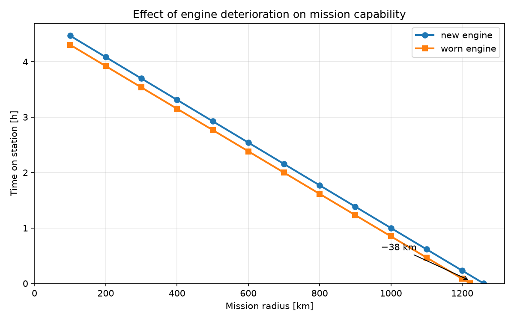

---

## How it fits together

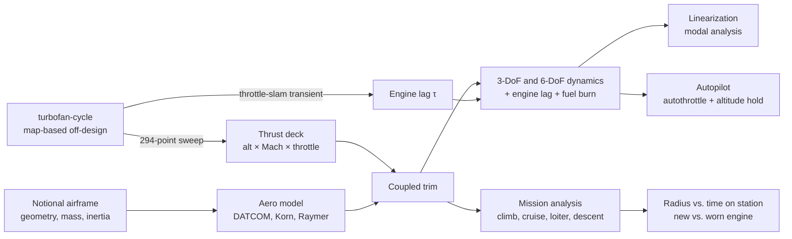

## Results

### Engine: thrust deck
A small low-bypass turbofan (BPR 0.9, OPR 21, 28.7 kN sea-level static, dry) is designed with turbofan-cycle and swept over 0–12 km, Mach 0–0.9 and idle to max dry. The max-dry rating is limited by T4 at low altitude and by corrected fan speed at altitude. At altitude, thrust rises again with Mach as ram pressure lets the fan swallow more air at its speed limit.

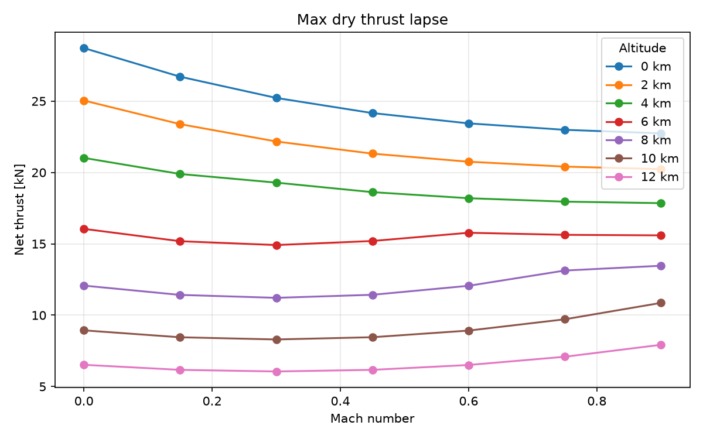

### Airframe and trim
Conceptual-design methods give CLα = 3.3 /rad, CD0 = 0.014 and (L/D)max = 12.8; the Korn equation puts drag divergence at Mach 0.94 (t/c 5 %, 33° quarter-chord sweep). Trimming engine and airframe together over the envelope shows specific range rising with altitude until thrust runs out: the best point, **15 km, Mach 0.85 (2.02 km/kg)**, sits at the MTOW service ceiling, as expected for a jet. Higher up, the same CL needs more speed, so the optimum Mach moves up with altitude until wave drag sets in.

| Drag polars | Specific range over the envelope |

### Ceilings
Rate of climb at max dry thrust, RC = (T − D)·V / W, maximized over Mach at each altitude. Above the top of the deck (15 km) thrust is scaled with ambient pressure: in the isothermal layer the engine runs at a fixed corrected point, so F/δ is constant (checked on the deck: 12 → 15 km thrust ratio 0.62 vs. pressure ratio 0.623).

| Mass | Cruise ceiling (1.5 m/s) | Service ceiling (0.5 m/s) | Absolute ceiling |
|---|---|---|---|
| MTOW, 6000 kg | 14 725 m | 15 035 m | 15 207 m |
| Half fuel, 5100 kg | 15 723 m | 16 066 m | 16 237 m |

Burning 900 kg of fuel raises the ceiling by 1 km, which is why jets step-climb.

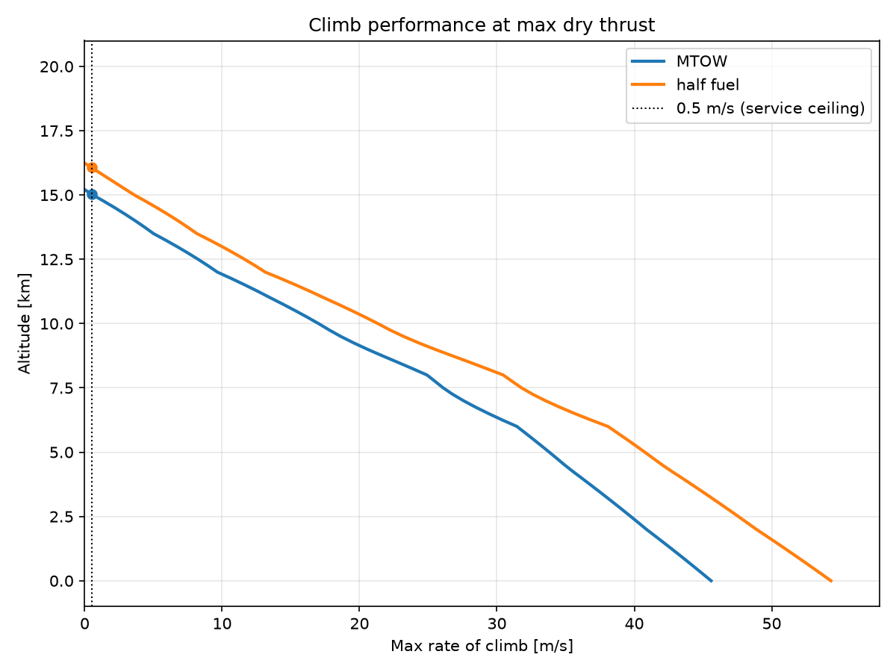

|---|---|
| 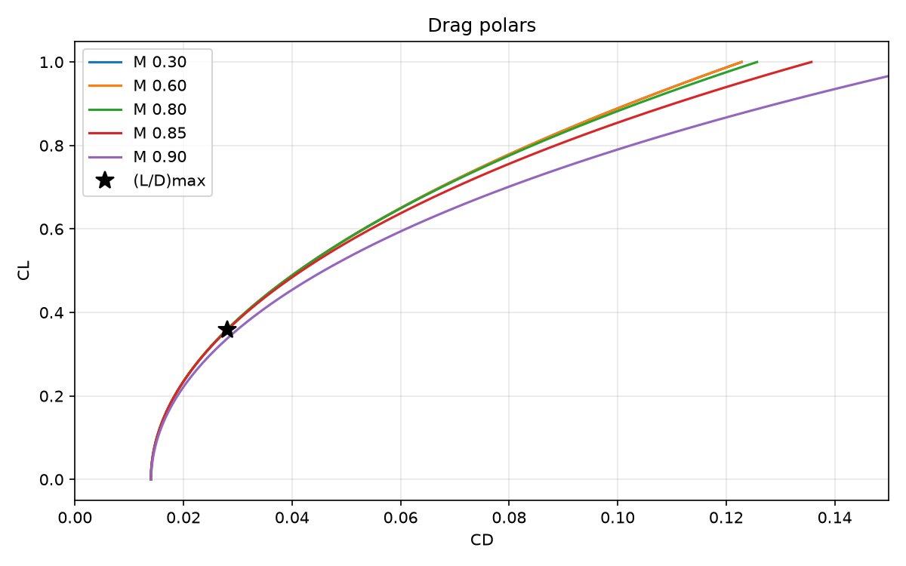 | 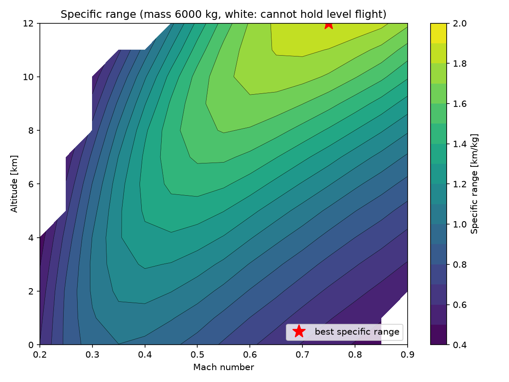 |

### Dynamics
Linearized about 6 km / Mach 0.6:

| Mode | Result | Flying qualities (MIL-F-8785C, cat. B) |
|---|---|---|
| Short period | ωn = 3.66 rad/s, ζ = 0.44 | Level 1 (0.30 ≤ ζ ≤ 2.0) |
| Phugoid | T = 86.8 s, ζ = 0.061 | Level 1 (ζ ≥ 0.04) |
| Engine | τ = 1.02 s | fitted to the turbofan-cycle transient |
| Height mode | τ = 750 s | stable (density gradient) |

| Elevator doublet | Engine lag fitted to the transient model |
|---|---|
| 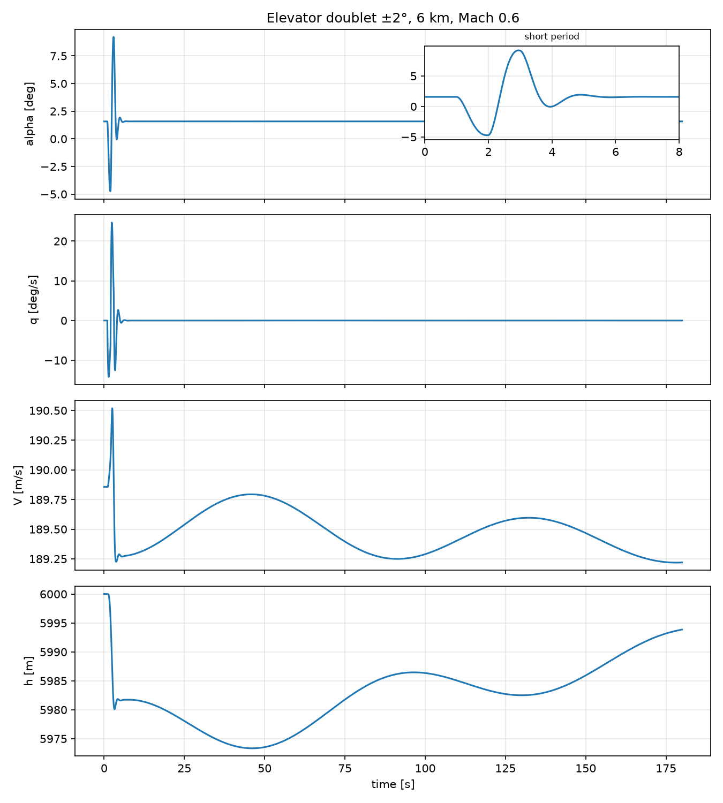 | 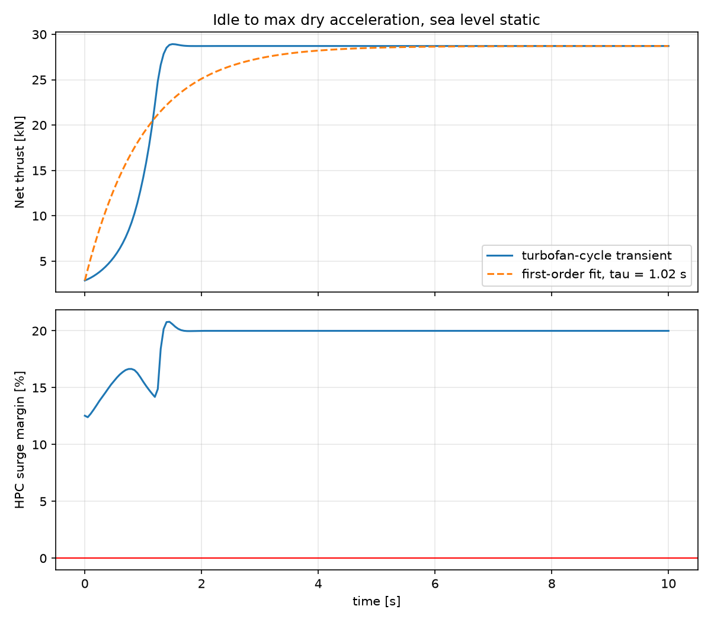 |

### Lateral-directional (6-DoF)
Full 6-DoF equations (Euler angles, north-east-down position) with representative fighter-class lateral derivatives. With the lateral states at zero the 6-DoF model reproduces the 3-DoF model to 1e-12, away from trim as well. Linearized at 6 km / Mach 0.6 and checked against the classical approximations:

| Mode | 6-DoF linear | Approximation | Nonlinear simulation | MIL-F-8785C level 1 |
|---|---|---|---|---|
| Dutch roll | ωn = 3.13 rad/s, ζ = 0.104 | 2.97 rad/s, 0.120 (sideslip + yaw) | period 2.02 s, ζ = 0.104 | ζ ≥ 0.08, ζωn ≥ 0.15 ✓ |
| Roll | τ = 0.327 s | 0.333 s (pure roll) | — | τ ≤ 1.4 s ✓ |
| Spiral | τ = 68 s, stable | 58 s (Cook, with g/V) | 69 s from bank decay | stable ✓ |

The spiral approximation must keep gravity: the mode is the slow bank-sideslip-yaw loop that gravity closes. Hands off after a 22° bank, the aircraft loses 193 m and turns 66° before the spiral mode levels the wings, which is why a heading hold is needed.

| Rudder doublet: Dutch roll | Aileron pulse: spiral mode |
|---|---|
| 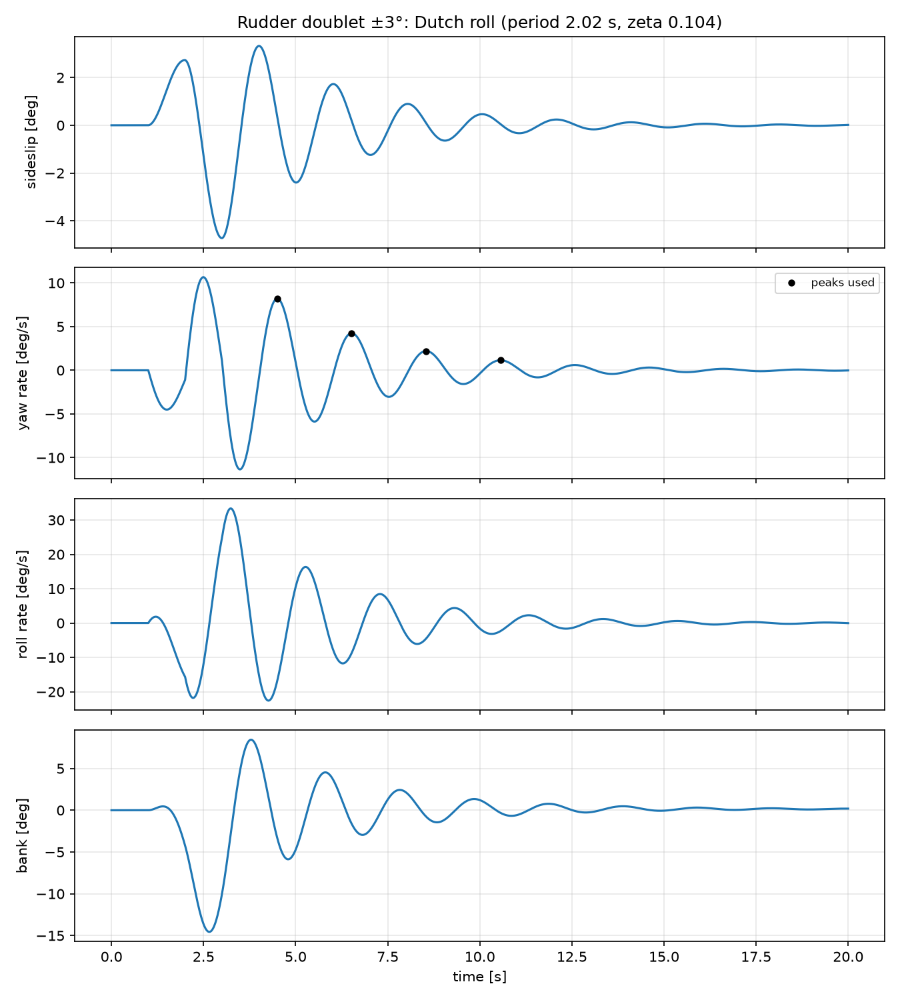 | 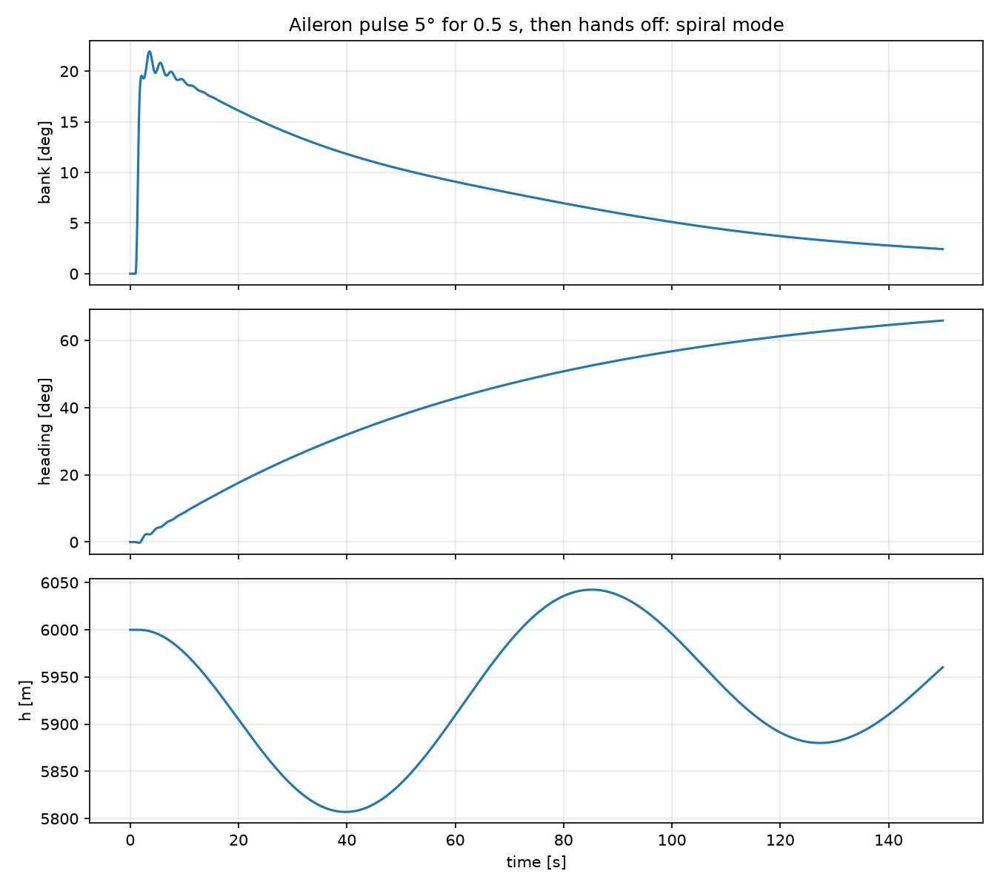 |

### Autopilot
PI autothrottle with anti-windup; altitude hold with a rate-limited pitch-attitude inner loop and integral action. A 20 m/s speed step disturbs altitude by 6 m; a 500 m altitude step overshoots by 4.4 % with elevator activity under 1°. Digital implementation at 50 Hz, fixed-step RK4.

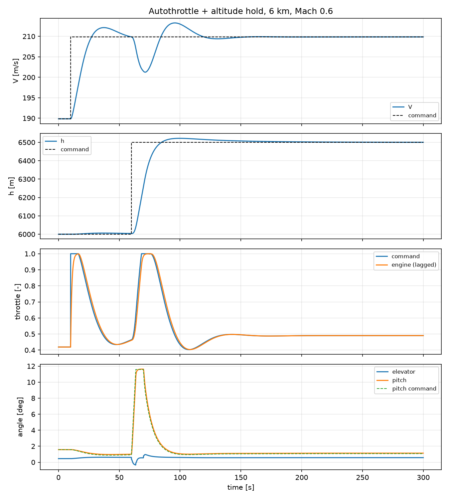

### Mission
Quasi-steady segments: climb by specific excess power, cruise and loiter by re-trimming every step, idle descent.

- **Loiter optimum:** at every altitude the minimum-fuel-flow point sits at L/D ≈ 12.7, i.e. (L/D)max, as theory predicts for a jet. The best altitude (6–8 km, 283 kg/h) comes from the engine: TSFC is poor low down (hot air) and high up (low throttle). Loitering at cruise altitude costs only 1.4 % more and avoids a descent and re-climb.
- **Radius vs. time on station:** every extra 100 km of radius costs 23 min on station; maximum radius 1260 km with a 10 % fuel reserve.

| Loiter fuel flow | Example mission (400 km, 2 h on station) |
|---|---|
| 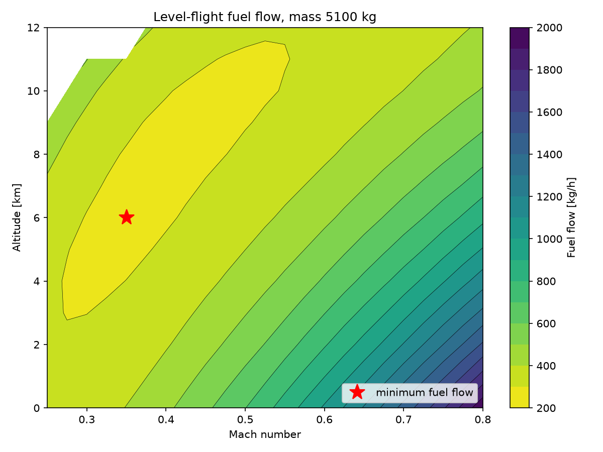 | 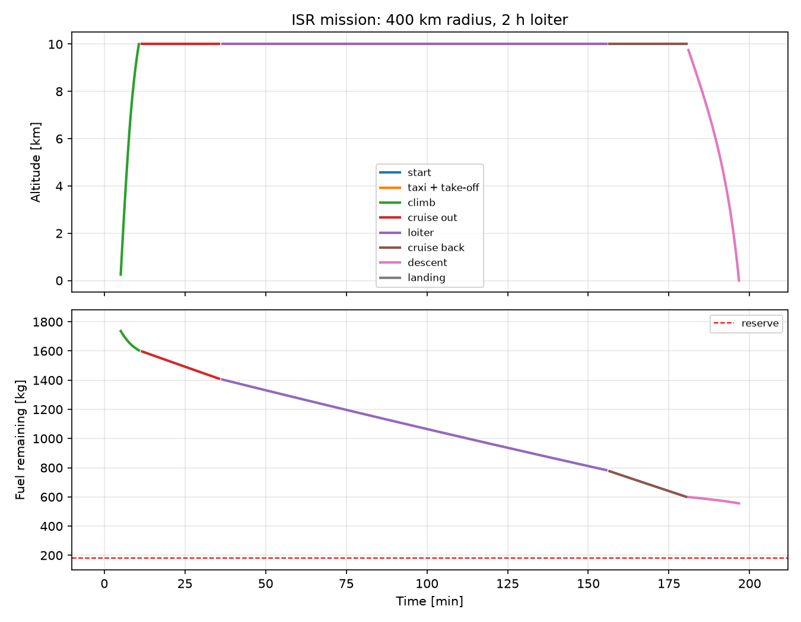 |

### Engine deterioration
A representative mid-life wear pattern (compressor fouling, opened turbine tip clearances: 1–2 % efficiency losses) is applied through turbofan-cycle's health parameters and a second thrust deck is generated.

- Where the rating is **T4-limited** (low altitude), the worn engine loses 8 % thrust.
- Where it is **fan-speed-limited** (altitude), it keeps its thrust by running hotter, which is why engines are rated on N1.
- In the mission, the loss comes from **TSFC** (+~3.5 %), not thrust: **−38 km radius, ~10 min less on station at every radius**, up to −15 % of station time at 1000 km.

### Uncertainty
200-sample Monte Carlo on the maximum radius, with Oswald factor (Raymer × 0.85–1.00), CD0 (± 15 %), empty mass (σ = 3 %) and engine wear (new to mid-life) sampled independently. Engine wear in between is a linear blend of the new and worn decks, valid because the engine responds linearly to small health changes (the basis of gas path exchange rates).

- **Max radius: 1231 km median, 1087–1381 km (90 %)**; the design-value answer (1258 km) is reached in only 42 % of samples.
- **CD0 drives almost all of it** (Spearman ρ = −0.98; ±15 % CD0 swings the radius by 327 km). At 10 km / Mach 0.75 the aircraft flies at CL ≈ 0.18, half the best-L/D value, so ~80 % of the drag is parasite drag and the Oswald factor barely matters. The next engineering investment for this design is pinning down CD0 (CFD or wind tunnel).

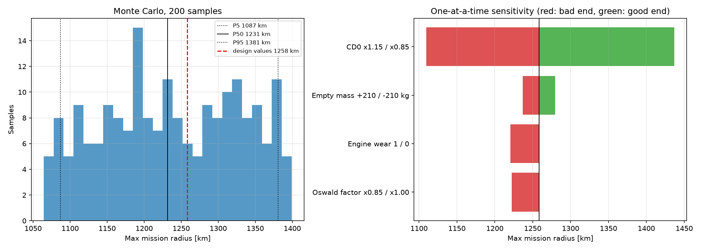

## Validation

| Check | Model | Reference | Difference |
|---|---|---|---|
| ISA atmosphere at 11 km | 22 632 Pa, 0.3639 kg/m³ | ISA tables | exact |
| Trim is an equilibrium | du, dw, dq < 1e-10 | 0 | — |
| Phugoid period (linear model) | 86.8 s | Lanchester, π√2·V/g = 86.0 s | +0.9 % |
| Outbound cruise fuel | 194.3 kg | Breguet range equation, 192.8 kg | +0.8 % |
| Loiter-optimum L/D | 12.70 | (L/D)max = 12.81 | −0.9 % |
| Loiter lost per 100 km of radius | 0.385 h | hand calc: 200 km ÷ 1.85 km/kg ÷ 285 kg/h = 0.38 h | +1 % |
| Engine mode in the linear model | τ = 1.02 s | engine lag in the nonlinear model | exact |

| Max radius, two methods | 1258 km (out-and-back, fuel to reserve) | 1260 km (loiter time extrapolated to zero) | −0.2 % |

| 6-DoF reduces to 3-DoF | all derivatives | 3-DoF model, off-trim state | < 1e-12 |
| Dutch roll, nonlinear sim | 2.02 s, ζ = 0.104 | linear model eigenvalue | exact to 3 digits |
| Spiral, nonlinear sim | 69 s | linear model, 68 s | +1.5 % |

The Breguet difference is expected: Breguet freezes L/D and TSFC, the simulation re-trims every minute as the aircraft gets lighter.


## Limitations and next steps

- **Lateral derivatives are representative textbook values,** not estimated from a vertical-tail geometry; product of inertia Ixz neglected; no lateral autopilot (heading hold) yet.
- **Engine lag is first-order.** The transient actually has a fast HP-spool rise and a slow LP-spool tail (95 % thrust at 1.35 s vs. 3τ = 3.1 s); a two-time-constant model would capture it.
- **No FADEC T4 limiter in the transient:** T4 overshoots to 1760 K during acceleration (rating: 1650 K).
- **Missions cruise at 10 km,** well below the ~14.7 km cruise ceiling; cruising (and step-climbing) at the ceiling would add roughly 20–25 % range. The worn-engine deck still ends at 12 km, so the deterioration study is kept at 10 km for a like-for-like comparison.
- **Conceptual aerodynamics:** the swept-wing Oswald factor (0.88) is optimistic; real values are 0.75–0.85.
- **Fixed autopilot gains;** gain scheduling over the envelope is needed for a production design.
- **Notional aircraft and illustrative wear pattern,** not data of any real aircraft or engine fleet.

## Running it

```bash
git clone --recurse-submodules https://github.com/SirPicklee/jet-uav-engine-airframe-integration.git
cd jet-uav-engine-airframe-integration
python -m venv .venv
# Windows: .venv\Scripts\activate     Linux/macOS: source .venv/bin/activate
pip install -e ".[dev]"
pytest                                   # 30 tests
```

Thrust decks are committed in `data/`; regenerating them takes ~15 min each:

```bash
python scripts/build_thrust_deck.py          # new engine
python scripts/build_thrust_deck.py --worn   # deteriorated engine
```

| Script | What it does |
|---|---|
| `plot_aero.py` | drag polars, transonic drag rise |
| `plot_trim_map.py` | specific range and throttle over the 
| `ceiling.py` | rate of climb, cruise/service/absolute ceilings |
| `monte_carlo.py [-n N]` | uncertainty and sensitivity of the max radius |

envelope |
| `sim_elevator_doublet.py` | short period and phugoid in the time domain |
| `modal_analysis.py` | linearization and eigenvalues |
| `fit_engine_lag.py` | throttle slam with turbofan-cycle, first-order fit |
| `sim_autopilot.py` | speed and altitude steps with the autopilot |
| `run_mission.py` | example mission with the Breguet check |
| `find_loiter_optimum.py` | minimum fuel flow over the envelope |
| `radius_endurance.py [--worn]` | radius vs. time on station |
| `compare_deterioration.py` | new vs. worn engine |

## Project structure

```
src/jet_uav_sim/
  engine.py        UAV turbofan definition, rating, wear case
  thrust_deck.py   deck generation and interpolation
  airframe.py      wing geometry, mass, inertia
  aero.py          longitudinal aerodynamics
  atmosphere.py    ISA
  trim.py          coupled engine–airframe level-flight trim
  dynamics.py      3-DoF equations of motion with engine lag and fuel burn
  linearize.py     numerical Jacobians, modes
  control.py       autothrottle, altitude hold
  sim.py           closed-loop RK4 simulation
  mission.py       quasi-steady mission segments
external/turbofan-cycle   engine model (git submodule)
```

## References

- Raymer, *Aircraft Design: A Conceptual Approach*, 6th ed.: skin-friction drag, Oswald factor
- USAF DATCOM: lift-curve slope
- Mason, *Transonic Aerodynamics of Airfoils and Wings*: Korn equation, drag rise
- Roskam, *Airplane Design Part V*: radii of gyration
- Etkin & Reid, *Dynamics of Flight*; Stevens & Lewis, *Aircraft Control and Simulation*: flight dynamics
- MIL-F-8785C, *Flying Qualities of Piloted Airplanes*
- Walsh & Fletcher, *Gas Turbine Performance*: engine ratings, deterioration

## License

MIT